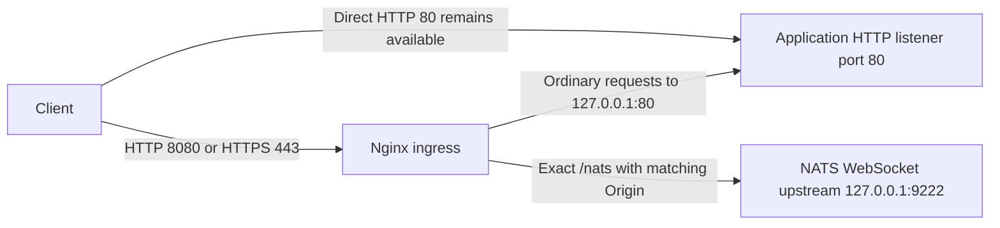

# Application/platform contracts

These contracts describe the existing integration boundary between proto-distro
and application packages. They identify platform and application roles, not
particular executables or systemd service names.

## Contract index

This index links the existing documentation and current platform sources. The
linked documents remain authoritative for their detailed contracts; this index
does not replace them with application internals or a service-name registry.

| Boundary | Documentation or current source | Ownership |
| --- | --- | --- |
| Lifecycle | [Boot hooks](#lifecycle) | The distro owns platform boot phases; application packages own their initialization. |
| Manufacturing ownership | [Manufacturing and persistent state](#manufacturing-and-persistent-state) | The distro supplies `VARIANT=mfg`; applications own onboarding and authentication behavior. |
| HTTP | [HTTP integration](#http-integration) | The distro owns ingress and TLS; applications own upstream HTTP behavior. |
| NATS | [NATS configuration contract](../sources/meta-miner/recipes-core/nats-server/README.md) | The distro owns broker configuration; applications own their messages and subjects. All APP subjects are browser-readable, and JetStream storage is ephemeral. |
| Packaging | [Distro injection](../tools/distro/README.md#distro-inject) and [application package production](https://github.com/block/miner-firmware/blob/main/tools/crossbuild/README.md#packaging) | Application packages own their contents and lifecycle integration; distro tooling owns image injection. |
| PSU firmware | [PSU firmware ownership](#psu-firmware-ownership) | Applications own selection and updating. |

Package-install staging remains an integration boundary: current offline injection
executes package postinstall scripts. It does not guarantee deferred application
activation. See [injection behavior](../tools/distro/README.md#package-selection-and-offline-installation).

## PSU firmware ownership

Application tooling owns format interpretation,
device discovery, compatibility matching, selection, and update behavior.

Public consumers must acquire and package separately licensed firmware. No
fallback firmware or runtime downloader is added.

## Lifecycle

The platform exposes three systemd phase barriers, in this order:

| Target | Eligibility |
| --- | --- |
| `application-first-boot.target` | First device boot, after the platform firstboot core; interrupted firstboot may retry on a later boot. |
| `application-ota-boot.target` | Pending rootfs update only, after the platform OTA core. |
| `application-boot.target` | Every boot, after the platform every-boot core. |

Each eligible parent synchronously starts its target in `ExecStartPost`, with
an ignored failure. Later phases and ordinary daemons wait for that barrier.
Targets keep their default dependencies: their weak `Wants` hooks are ordered
before the target. Independent hooks run concurrently; same-phase hooks may
explicitly order one another without introducing cycles. Failed or timed-out
hooks remain visible through `systemctl status`, `systemctl show`, and the
journal, but do not prevent the target, later phases, or ordinary daemons from
proceeding. An empty target succeeds.

Platform parent units resolve `systemctl` through Yocto's `${base_bindir}`
at installation time (`/bin/systemctl` on split-`/usr` images), rather than
assuming `/usr/bin/systemctl` exists.

Before the every-boot application barrier, `miner-boot.service` synchronously
starts the platform-owned `miner-boot-security.service`. This bounded oneshot
runs `boot-security.sh` to select SSH and the open or secure NATS instance.
The selection policy is unchanged, including defaulting to secure mode when
the security checker is unavailable. Security-service failure remains visible
but does not skip application hooks or fail the platform parent. The service
is invoked by the parent's `ExecStartPost`, not enabled under `multi-user.target`
or registered as an application hook. Restarting the parent reruns security
selection before checking the already-reached application target.

`miner-firstboot.service` disables itself only after its synchronous hook barrier
returns and `application-first-boot.target` is active, not from the platform core
script. The core retains its best-effort exit behavior. If power loss, a reset,
or a shutdown interrupts the barrier before the target is reached, firstboot
remains enabled and the next boot retries the core and its hooks, including hooks
that already completed before the interruption. A reached target still permits
disablement when individual hooks fail or time out; those failures do not
request a retry on the next boot.

Targets remain active once reached within the current boot. Each parent checks
`is-active` before starting its target, so a parent restart does not replay
successful, failed, timed-out, or newly installed hooks belonging to a reached
target. An inactive target that was skipped or never reached remains eligible
for a later parent start. Explicit administrative target stop/start is outside
this guarantee.
Parent restarts may rerun platform cores, including the OTA core while an update
is pending; this contract does not promise platform-core idempotence.

Package installation or a version change does not itself trigger a phase.
A newly installed hook waits for its next eligible boot. In particular, adding
a firstboot hook after firstboot has disabled itself does not run that hook.

### Package-owned hooks

Hook scripts must be safe to retry after partial execution, including across
boots. Prefer idempotent operations. Guard operations that cannot be repeated by
checking durable application state or using an operation-supported idempotency
key. Record completion only after the operation succeeds. A separate completion
marker alone does not close the power-loss window between the operation and the
marker write; provide recovery for an interrupted operation. Neither systemd
oneshots nor target activation provide exactly-once execution across power loss.

Every hook must set `TimeoutStartSec=5min`. Oneshot services otherwise have no
default startup timeout; a hung hook can block its phase and later boot services
indefinitely. The five-minute timeout bounds each hook, not the entire phase.
Timed-out hooks remain failed and visible while the weak target dependency
allows boot to continue.

Give each hook a unique unit name and exactly one `WantedBy` phase. For example,
`example-app-boot.service`:

```ini
[Unit]
Description=Initialize example application

[Service]
Type=oneshot
TimeoutStartSec=5min
ExecStart=/usr/libexec/example-app/initialize

[Install]
WantedBy=application-boot.target
```

This is a documentation example, not a platform-installed hook. The executable
belongs to the application package. Both IPK and deb must carry the same unit
and relative vendor symlink:

```text
/lib/systemd/system/example-app-boot.service
/lib/systemd/system/application-boot.target.wants/example-app-boot.service -> ../example-app-boot.service
```

Insert these fragments into the existing packager definitions; they are not
new package schemas. For Rust package metadata:

```toml
[package.metadata.nfpm]
contents = [
    { src = "install_files/example-app-boot.service", dst = "/lib/systemd/system/example-app-boot.service" },
    { src = "../example-app-boot.service", dst = "/lib/systemd/system/application-boot.target.wants/example-app-boot.service", type = "symlink" },
]
```

For Go nFPM configuration, append both entries to the existing `nfpms[].contents`:

```yaml
nfpms:
  - contents:
      - src: install_files/example-app-boot.service
        dst: /lib/systemd/system/example-app-boot.service
      - src: ../example-app-boot.service
        dst: /lib/systemd/system/application-boot.target.wants/example-app-boot.service
        type: symlink
```

The symlink `src` is literal link text, not a path into the checkout. Ship the
link in the package; do not run `systemctl start` or `systemctl enable --now`
when installing this example. Production application installation scripts are
unchanged by this contract.

### Ordering boundaries

Hooks must not depend on their invoking parent, any later phase,
`multi-user.target`, or an ordinary daemon waiting for `miner-boot.service`.
Those dependencies can form cycles with the synchronous barrier. Network-dependent
or longer-running work belongs in ordinary services, not boot hooks.

Ordinary daemons use `After=miner-boot.service` and
`Wants=miner-boot.service`; existing stronger `Requires` dependencies may remain.
Application update confirmation is independent of application phase hooks.
MCDD owns database initialization during normal daemon startup.

## Manufacturing and persistent state

The [manufacturing image](../sources/meta-miner/recipes-core/images/miner-image-mfg.bb)
sets `VARIANT="mfg"` in `/usr/lib/os-release`. Applications own onboarding state
and behavior.

`/etc` uses a persistent `/data/overlay-etc` upper layer. This is not a general
application configuration migration interface. The
[preinit reconciliation](../sources/meta-miner/recipes-core/images/files/overlayfs-etc-data-preinit.sh.in)
compares rootfs `VERSION` and `VARIANT` with `/data/overlay-etc/.user-state`.
On a change, including downgrade or rollback, it removes upper-layer `os-release`
and `passwd`, replaces upper-layer `shadow` from the rootfs with an empty root
password field, and copies the rootfs admin sudoers file when present. It then
records the new state. Root login still depends on the rootfs login shell;
release uses `nologin`. These actions can replace locally changed account and
password state. They do not reconcile arbitrary application files in `/etc`.
Unchanged version/variant state does not trigger this reconciliation.
The [every-boot core](../sources/meta-miner/recipes-core/miner-boot/files/boot.sh)
also refreshes `/etc/os-release` when rootfs version or variant differs.

## OTA confirmation and rollback

Confirmation is independent of application phase hooks. The platform command
[`proto-swupdate confirm`](../tools/proto-swupdate/cmd/proto-swupdate/main.go)
clears pending rootfs `ustate=1` to `0`, attempts to clear reverted `ustate=3`,
and clears the boot counter. It performs no application health checks. FIP
confirmation logs available FWU metadata and boot-bank state; it does not change
bank acceptance metadata. FIP diagnostic failure does not block rootfs confirmation.

The current application package supplies
[`update-confirm.service`](https://github.com/block/miner-firmware/blob/main/services/mdk-server/install_files/update-confirm.service)
and [`update.sh`](https://github.com/block/miner-firmware/blob/main/services/mdk-server/install_files/update.sh).
The service wants and orders after MCDD and MDK, requires `/data`, and runs
`/usr/bin/update.sh --confirm`. During `ustate=1`, the script checks HTTP success
from `http://127.0.0.1/readyz`, active `mcdd.service`, and the Unix socket
`/run/mcdd/mdk.sock` before invoking `proto-swupdate confirm`. It allows 90
attempts with 10-second sleeps; each HTTP request has a 5-second connect timeout
and 10-second total timeout. This is not an exact 15-minute deadline because
checks also take time. Confirmation failure or exhausted attempts requests reboot.
For nonpending or reverted state, it invokes confirmation without these readiness
checks. These are application-owned checks, not a new platform readiness policy
or proof of mining, hardware, network, or fleet health.

The [release boot script](../sources/meta-miner/recipes-bsp/u-boot/files/boot-release.scr.cmd)
sets `ustate=3` and resets when pending state reaches boot count 3. Reverted state
switches the selected A/B rootfs slot and saves the environment. Confirmation
therefore ends the rootfs trial; boot-hook completion alone does not confirm it.

## Persistent logs, reset, and identity

The generic [shutdown archive script](../sources/meta-miner/recipes-core/save-logs-on-shutdown/files/save-active-logs.sh)
copies nonempty regular `/var/log/<directory>/*.log` files, excluding symlink
directories and files, to `/data/log/<directory>/<filename>-YYYYMMDD-HHMMSS.gz`.
This layout needs no application-name registry. It keeps the newest 30 matching
`*.log-*.gz` archives by modification time per destination directory, shared
across filenames; application logrotate rules may impose smaller limits.
Before each copy it requires 51,200 KiB free reserve plus source size, roughly
1% overhead, and 64 KiB. Insufficient space or copy failure warns and skips that
file. Temporary files avoid publishing incomplete gzip files.
The [service](../sources/meta-miner/recipes-core/save-logs-on-shutdown/files/save-logs-on-shutdown.service)
has a 30-second stop timeout. This is best-effort orderly-shutdown retention,
not a durable snapshot or abrupt-power-loss guarantee.

[`user_reboot.sh`](../sources/meta-miner/recipes-core/miner-reboot/files/user_reboot.sh)
distinguishes two destructive operations. `--factory-reset` sets the U-Boot
`factory_reset=y` flag. The release boot script copies recovery into rootfs A,
erases rootfs B, invalidates the beginning of the data partition, and selects A.
`--clear-user-settings` instead tries to unmount `/data` and zeros the first
10 MiB of `/dev/mmcblk0p10`. Neither is a selective application-settings reset:
data loss includes the `/etc` overlay, application data, and persistent logs.
The preinit script can also recreate the data filesystem after a failed
filesystem check. Back up required state before reset.

The reboot helper treats existence of `/tmp/swupdate/ready_to_reboot` as the
Memfault firmware-update reboot reason (`3`), otherwise user reset (`2`).
That marker is reboot-reason input, not application readiness or update
confirmation evidence.

Identity has several separate files, not a single application identity schema:

- `/usr/lib/os-release` carries rootfs version, variant, and machine metadata;
  `/etc/os-release` exposes the runtime copy described above.
- [`miner-hostname`](../sources/meta-miner/recipes-core/miner-hostname/files/init_hostname.sh)
  writes `/etc/hostname` as `proto-miner-` plus the last four hexadecimal digits
  of `eth0`'s MAC address (fallback `0000`), applies it, and disables itself.
  This short suffix is not a uniqueness guarantee.
- [`get_serial.sh`](../sources/meta-miner/recipes-core/miner-boot/files/get_serial.sh)
  reads the manufacturing serial from STM32 nvmem. The every-boot core appends
  `MFG_SERIAL_NUMBER` to `/etc/machine-info` only when nonempty and no such key
  already exists; it does not reconcile an existing value.
- [`memfault-device-info`](../sources/meta-miner/recipes-memfault/memfault-device-info/files/memfault-device-info)
  consumes that serial for `MEMFAULT_DEVICE_ID` and os-release fields for hardware
  and software identification. This documents the inspected platform consumer,
  not a guarantee that every application consumes these files or uses the same ID.

## Ownership and provenance references

Classify a reference by what uses it, not by whether it names another repository:

- **Ownership and provenance:** keep the [README downstream ownership link](../README.md),
  recipe/source attribution, and [fastboot import attribution](../tools/go_fastboot/README.md).
  These explain responsibility or origin; they do not select an application
  executable, configuration path, or boot action.
- **Historical signing provenance:** keep the original release URL in
  [FSBL metadata](../sources/meta-miner/recipes-dev/miner-signing-keys/files/dev/fsbl/c3/METADATA)
  and the [production key-hash example](../sources/meta-miner/recipes-dev/miner-signing-keys/files/prod/gen-pkhash.sh).
  A historical signing source must not be rewritten to a newer repository.
- **Executable behavior and configuration:** the generic
  [release fetch interface](../tools/distro/README.md#distro-fetch) remains
  supported, but the root [configuration](../distro.yaml) defines no
  `fetch.sources`. Consumers must define sources in a custom configuration and
  pass it with `distro --config path/to/fetch.yaml fetch ...`. Those configured
  repositories and tags select real artifact interfaces, not historical
  provenance; source flags are not built-in defaults.

The [PSU driver source README](../sources/meta-miner/recipes-kernel/psu-pmbus-driver/proto-psu-driver)
belongs to the upstream submodule and retains its recipe attribution. For the
current distro build, the [local PSU driver recipe](../sources/meta-miner/recipes-kernel/psu-pmbus-driver/psu-pmbus-driver.bb)
uses the checked-out submodule through `file://proto-psu-driver`; the upstream
README is not a description of this recipe's fetch mechanism.

Correct explanatory text only when the implemented contract contradicts it.
Do not remove a valid ownership link to hide behavioral coupling, change release
repositories to eliminate a textual mention.

## HTTP integration

The distro owns the nginx ingress configuration and TLS termination. Application
packages own the HTTP upstream, its API behavior, and dashboard content. The
local NATS broker provides the WebSocket upstream for browser telemetry. Changes
to these listener addresses must be coordinated across both sides of the
boundary; documenting them does not migrate networking or change security policy.



### Listeners and routing

The current [nginx configuration](../sources/meta-miner/recipes-httpd/nginx/files/default.conf)
listens on HTTP **8080** and HTTPS **443**:

- Ordinary application requests proxy to `http://127.0.0.1:80`. The request path
  and query remain unchanged. The application owns routing behind this upstream;
  nginx does not maintain an application endpoint inventory.
- Only the exact `/nats` location proxies to `http://127.0.0.1:9222/`. Its upstream
  path becomes `/`, with the query retained. `/nats/` and paths beneath it use the
  ordinary application upstream, not the WebSocket upstream.
- The [NATS WebSocket configuration](../sources/meta-miner/recipes-core/nats-server/files/nats-websocket.conf)
  binds `127.0.0.1:9222` with `no_tls: true`. HTTPS terminates at nginx; the local
  upstream connection is unencrypted.

Loopback is nginx's upstream destination, **not** a requirement that the
application listen only on loopback. The packaged
[application listener configuration](https://github.com/block/miner-firmware/blob/main/services/mdk-server/install_files/mdk-server.service)
binds HTTP to `0.0.0.0:80`, retaining direct application access on port **80**.
The distro's [Avahi advertisement](../sources/meta-miner/recipes-core/avahi/files/http.service)
continues to advertise `_http._tcp` on port **80** with `path=/`. Neither direct
access nor discovery is moved to nginx's port 8080 or HTTPS port 443.

### Same-origin enforcement and headers

Both nginx listeners apply the same rule to exact `/nats` requests:

```nginx
if ($http_origin != "$scheme://$http_host") {
    return 403;
}
```

`Origin` must exactly equal nginx's request scheme plus the incoming `Host`
header, including an explicit port when present. A missing or mismatching
`Origin` receives **403** before reaching the WebSocket upstream. For example,
`Host: rig.example:8080` requires `Origin: http://rig.example:8080`; HTTPS with
`Host: rig.example` requires `Origin: https://rig.example`. This check applies to
the nginx WebSocket location, not ordinary application requests or direct HTTP
port 80 access. It does not replace application or broker authentication.

For ordinary application requests, nginx sets:

- `Host: $host` (the host without the incoming port).
- `X-Real-IP: $remote_addr` (nginx's client address).
- `X-Forwarded-For: $proxy_add_x_forwarded_for` (the incoming value, if any,
  followed by nginx's client address).
- `X-Forwarded-Proto: $scheme` (`http` or `https` at nginx).

For exact `/nats`, nginx uses upstream HTTP/1.1 and sets `Upgrade: $http_upgrade`,
`Connection: upgrade`, and `Host: $host`. The incoming `Origin` is forwarded.
This location does not generate `X-Real-IP`, `X-Forwarded-For`, or
`X-Forwarded-Proto`; client-supplied headers otherwise retain nginx's normal
pass-through behavior. Both proxy read and send timeouts are **1 hour**.

### TLS and application API ownership

HTTPS uses `/etc/nginx/ssl/nginx.crt` and `/etc/nginx/ssl/nginx.key`, with
TLS **1.2** and **1.3** and cipher policy `HIGH:!aNULL:!MD5`. HTTP 8080 remains
HTTP; the current configuration does not redirect it to HTTPS. This contract
preserves existing TLS settings, routes, direct HTTP exposure, Avahi advertising,
and security behavior.

Use the existing [MDK API definition](https://github.com/block/miner-firmware/blob/main/crates/miner-api-server/docs/MDK-API.json)
and [application API documentation](https://github.com/block/miner-firmware/blob/main/services/mdk-server/README.md)
for application endpoints and API semantics. Those remain application-owned;
this document does not introduce an endpoint or service-name registry.

### Log storage and retention

Nginx records only 4xx and 5xx responses in the access log. These records go to
journald through its local syslog socket with identifier `nginx_access` at
`warning` severity. Error records at `error` severity and higher use identifier
`nginx` and retain their original severity. Read both with
`journalctl -t nginx -t nginx_access`. Runtime stderr is restricted to `emerg`
severity to prevent duplicate ordinary error records. Startup and configuration
failures still go to stderr, which the systemd service captures. Release and
manufacturing images share this policy.

Journald forwards these records to rsyslog, which writes
`/var/log/nginx/access.log` and `/var/log/nginx/error.log`. Size-based logrotate
archives go to `/data/log/nginx`; `save-logs-on-shutdown` saves the active files
there on orderly shutdown, including OTA reboots. Abrupt power loss does not
save active files.

Retention settings live in
[`journald.conf`](../sources/meta-miner/recipes-core/systemd/files/journald.conf)
and [`nginx-logrotate.conf`](../sources/meta-miner/recipes-httpd/nginx/files/nginx-logrotate.conf).
The logrotate size threshold is checked by the existing timer, not a hard cap.
