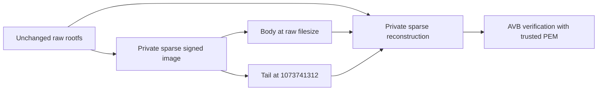

The proto-distro-security-tools Python package is a collection of tools used for security signing and key management of proto-distro images.

The Python package is installed in both the distro builder and injector Docker images and can also be used independently for development and testing.

Detailed readmes for each sub-tool can be found in their respective folders.

## Standalone wheel

Tools releases (`tools-*` tags) attach one `proto_distro_security_tools-<version>-py3-none-any.whl`
with seven commands: `fsbl_signer`, `cot_signer`, `optee_keys`,
`replace_uboot_avbkey`, `create_avb_image`, `verify_avb_image`, and `avbtool`.
Download the wheel from the `block/proto-distro` tools release, then run:

```bash
export UV_DEFAULT_INDEX=https://pypi.org/simple
uvx --python 3.12 --from /absolute/path/to/proto_distro_security_tools-0.0.8-py3-none-any.whl create_avb_image --help
uvx --python 3.12 --from /absolute/path/to/proto_distro_security_tools-0.0.8-py3-none-any.whl avbtool --help
```

The supported platforms are macOS and Linux, each on arm64 and x86_64. Python
3.12 or newer is required; CI tests Python 3.12 on all four native platforms.
OpenSSL 3.x must be on PATH. The wheel includes the pinned, dm-init-patched AVB
implementation and its provenance; no Yocto sysroot or source checkout is needed.
It includes only the public default OP-TEE key, not signing keys or test fixtures.
`uvx` installs the declared Python dependencies; this is not an offline bundle of
Python, dependencies, or OpenSSL.

Project builds and locked dependencies use public PyPI so GitHub-hosted runners
can install them without access to Block Artifactory. Keep `UV_DEFAULT_INDEX` set
for standalone `uvx` and wheel smoke commands, which run outside project
configuration. Do not disable TLS verification to work around network errors.

On macOS:

```bash
brew install openssl@3 coreutils
export PATH="$(brew --prefix openssl@3)/bin:$(brew --prefix coreutils)/libexec/gnubin:$PATH"
```

GNU coreutils supplies `shred` for the existing optional CoT Vault-auth cleanup.
Local signing and verification do not need Vault credentials.
`replace_uboot_avbkey` retains its four positional arguments rather than `--help`:
`replace_uboot_avbkey <old.bin> <new.bin> <old.key> <new.key>`.

## Create signed rootfs metadata

```bash
uvx --python 3.12 --from /absolute/path/to/proto_distro_security_tools-0.0.8-py3-none-any.whl create_avb_image \
  --rootfs-image "rootfs image.ext4" \
  --privkey key.priv.pem --pubkey key.pub.pem --avbpubkey key.avbpubkey
```

This writes only `rootfs image.ext4.avb.body` and
`rootfs image.ext4.avb.tail` beside the caller's input path, printing body then
tail pathname. The plain ext4 stays unchanged. Signing uses a private sparse
1 GiB image, 1024-byte blocks, SHA-256, SHA256_RSA2048, no FEC, and signed Linux
dm-init arguments containing literal `PARTUUID=$(ANDROID_SYSTEM_PARTUUID)`.
The AVB public key file remains public-key metadata; the trusted public PEM
verifies the image. The private full image is removed after signing, not published.
Generation, verification, and extraction failures preserve both previous outputs.
Output aliases to inputs or each other, symlinks, and non-regular files are rejected.
Both outputs are validated before replacing either. Each rename is atomic, but
the two renames are **not atomic as a pair**. A publication interruption can leave
a mixed pair; verify all three artifacts together before use. Existing `.avb` and
`.avb.footer` files beside a standalone invocation remain untouched.

The shared Go distro pipeline invokes this installed CLI in `docker.injector.image`
after all rootfs mutation and filesystem checks. Yocto exports plain source images;
release and manufacturing build/postbuild/inject processing always generates body
and tail, even without packages or a VERSION update.

Configure the three independent AVB paths under `avb.<machine>` in `distro.yaml`:
`private_key`, `public_key`, and `avb_public_key`. They resolve relative to that
config, then through file symlinks. `c3-p1` uses C3 keys. Missing selected keys
are fatal for both release and manufacturing.
SWU `signing` credentials and `--swu-key-file/--swu-key-pass` remain separate.

Release and manufacturing SWUs contain gzip of only the plain ext4, plus the same published
`.avb.body` and `.avb.tail` bytes. Each member has its own hash and signed partition
offset; SWUpdate writes all three to the inactive slot before committing boot
variables. No full-partition AVB payload is published or compressed. Flasher and
SWU packaging treat body/tail as ordinary binary files; neither parses AVB metadata
nor verifies AVB signatures. Only successful signing and repackaging proceed to
checksums, ZIPs, and latest links. After SWUs succeed, distro removes only recognized
obsolete `<rootfs>.avb`, `<rootfs>.avb.original`, `<rootfs>.avb.footer`, and
`<rootfs>.avb.footer.original` siblings. ZIP injection preserves its input on failure;
folder backups do not roll back an already-mutated plain rootfs.

Signed payload generation does not prove hardware boot or locked-device OTA.
The updated proto-swupdate resolves a direct root partition or one single-backed
device-mapper layer through sysfs. Old updaters misidentify `/dev/dm-0`; **do not
use an old updater for rootfs OTA on a dm-verity boot.**
See [the migration guidance](../tools/distro/ARCHITECTURE.md#split-ota-installation)
before updating an existing device. Miner-firmware integration remains separate.

## Verify an AVB image

```bash
verify_avb_image --rootfs-image "rootfs image.ext4" \
  --body "rootfs image.ext4.avb.body" \
  --tail "rootfs image.ext4.avb.tail" --pubkey key.pub.pem
```

All four options are required. Verification needs neither a private key nor a
published full `.avb` file and accepts read-only inputs. Both commands accept
regular raw images, including filesystem-sparse files, but reject Android sparse
containers. Input symlinks are followed; generated filenames retain the caller's
pathname. The old `verify_avb_footer` command and compact input are not supported.

There is no custom container, manifest, or pure-VBMeta artifact. For signed image
`signed`, raw size `O`, VBMeta offset `V`, VBMeta size `S`, and partition size
`P = 1073741824`, let `E = round_up(V + S, 512)`:

- Body is exactly `signed[O:E]`: alignment bytes, complete hashtree, signed VBMeta,
  and tiny trailing alignment padding. Place it at raw filesize `O`.
- Tail is exactly `signed[P-512:P]`: 448 zero bytes followed by the standard
  64-byte `AVBf` footer. Place it at `1073741312`.
- Raw rootfs occupies `[0:O]` unchanged. The omitted gap occupies `[E:P-512]`.



The verifier reconstructs only a private sparse `rootfs.avb`, validates the standard
AVB layout and signing profile, then invokes bundled AVB cryptographic verification.
It requires one enabled rootfs hashtree and a signature from the trusted public PEM.
It also requires exactly the two dm-init command-line descriptors generated for that
hashtree and `PARTUUID=$(ANDROID_SYSTEM_PARTUUID)`, including their conditional flags.
Additional descriptors, including properties, are rejected.
It authenticates padded rootfs and signed VBMeta, not the terminal footer, original
unpadded length, or omitted gap. It does not prove hardware boot, device trust
compatibility, or locked-device OTA. Concatenating raw/body/tail is not flashable;
tail must be placed at the fixed partition offset.

To flash all three artifacts, use `cb_st_flasher --verity <image-directory-or-zip>`.
It requires plain ext4 and its same-basename `.avb.body`/`.avb.tail`, writes their
partition extents, and omits unused padding without erasing it. All three are
written together; there are no separate body/tail flashing options or metadata-only
write mode. Flashing does not prove authenticity; verify with the trusted PEM first.
Flashing and SWU packaging require 512-byte-aligned raw and body lengths, a 512-byte tail,
and nonoverlapping placement in the fixed partition. The signer and verifier also
support unaligned raw inputs, including 65535 bytes. See
[AVB flashing](../tools/cb_st_flasher/README.md#avb-optimization)
for slot selection, readback, and trust requirements.

## Container commands

Both builder and injector install the locked checkout into
`/opt/proto-distro-security-tools`, with seven command symlinks in `/usr/local/bin`.
The installation is non-editable and does not shadow system Python. The builder
keeps its `btcm` user and build entrypoint; the injector keeps root and its Go
entrypoint. Select security commands explicitly:

```bash
DOCKER_BUILDKIT=1 docker build -t ghcr.io/block/proto-distro-builder:latest -f docker/Dockerfile.builder .
DOCKER_BUILDKIT=1 docker build -t ghcr.io/block/proto-distro-injector:latest -f docker/Dockerfile.injector .
docker run --rm --network none --entrypoint create_avb_image \
  --mount type=bind,src="$IMAGE_DIR",dst=/images \
  --mount type=bind,src="$KEY_DIR/dm-verity-rootfs-signing-key.priv.pem",dst=/keys/private.pem,readonly \
  --mount type=bind,src="$KEY_DIR/dm-verity-rootfs-signing-key.pub.pem",dst=/keys/public.pem,readonly \
  --mount type=bind,src="$KEY_DIR/dm-verity-rootfs-signing-key.avbpubkey",dst=/keys/public.avbpubkey,readonly \
  ghcr.io/block/proto-distro-injector:latest \
  --rootfs-image /images/rootfs.ext4 \
  --privkey /keys/private.pem \
  --pubkey /keys/public.pem \
  --avbpubkey /keys/public.avbpubkey
```

`just build` uses the installed signer in the injector image, not the host checkout.
Existing local images are reused without pulling or rebuilding. After changing
these tools, run `just docker-build-injector` before `just build`; rebuilding only
the builder does not update the release signer. Distro stages signer outputs
privately and requires both body and tail. It rejects stale injectors that emit
`.avb` or `.avb.footer`, or omit either output. Rebuild with
`just docker-build-injector`; there is no runtime fallback or automatic rebuild.

Run builds from the repository root with BuildKit. Locked Python dependencies come from public PyPI;
standalone installs use the configured package index.
`IMAGE_DIR` and `KEY_DIR` must be absolute host paths. The same invocation works
with the builder tag. Make the image directory writable and keys readable by the
image default user; do not mount production keys during smoke checks. Runtime
commands need no network or checkout. Import the installed Python package using
`/opt/proto-distro-security-tools/bin/python`, not system `python3`.

## Build and verify

Install standalone [uv](https://docs.astral.sh/uv/getting-started/installation/),
then run from the repository root. No Hermit or host Python is required; uv
manages Python 3.12 and the project environment at `python/.venv`.

If your shell previously activated Hermit Python, clear its environment first
(or open a fresh shell):

```bash
unset VIRTUAL_ENV UV_PROJECT_ENVIRONMENT PYTHONUSERBASE PYTHONPYCACHEPREFIX PIP_CACHE_DIR
export PATH="$HOME/.local/bin:$PATH"
hash -r
```

```bash
export UV_DEFAULT_INDEX=https://pypi.org/simple
uv sync --managed-python --project python --locked --extra dev
uv run --managed-python --project python --locked create_avb_image --help
wheel_dir="$(mktemp -d)"
uv build --managed-python --python 3.12 --wheel python --out-dir "$wheel_dir"
uv run --managed-python --project python --locked --extra dev pytest \
  python/fsbl/tests python/cot_signer/tests python/optee_keys/tests python/replace_uboot_avbkey/tests
uv run --managed-python --python 3.12 --no-project python python/tests/smoke_wheel.py \
  --wheel "$wheel_dir/proto_distro_security_tools-0.0.0-py3-none-any.whl"
```

The smoke runner uses temporary HOME and scratch files, exercises all seven
installed commands, and checks body/tail publication, both output protections,
source preservation, and trusted verification. Full images are reconstructed only
inside scratch. Its synthetic block image is not a filesystem or board-boot test.
Release CI builds once in a staging copy,
tests that same wheel on all four platforms, and includes it in the release
checksum manifest. Source builds retain version `0.0.0`; `tools-0.0.8` stamps
`0.0.8` only in the staging copy. No PyPI publishing occurs.

