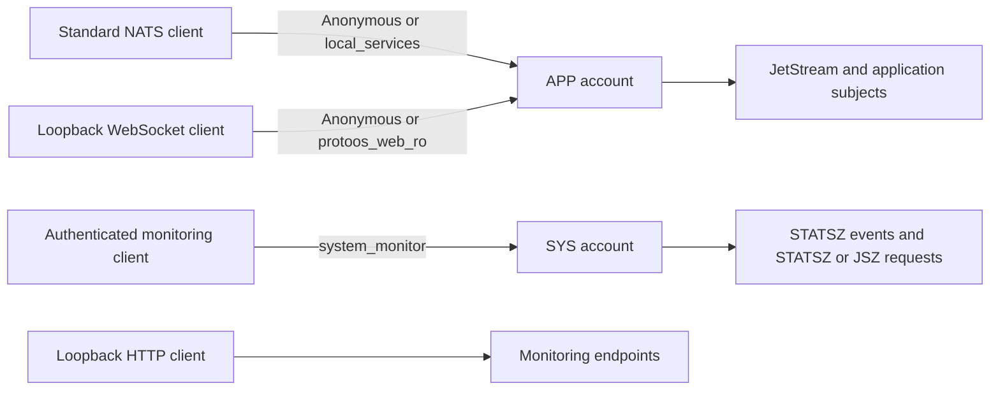

# NATS Server Configuration

This recipe installs NATS Server and a templated systemd service with two operating modes. The configuration separates application traffic from NATS system monitoring so application wildcard subscriptions cannot receive system events.

This README is the authoritative application/browser NATS contract. The distro
owns broker configuration, listener selection, account permissions, and resource
budgets. Applications own their subjects and message schemas within this
boundary. This documents existing behavior; it does not add a subject allowlist,
migrate message schemas, or redesign storage.

## Access overview



The `APP` and `SYS` accounts are isolated NATS subject namespaces. A subscription to `>` in `APP` does not receive `$SYS` events from `SYS`.

## Listeners

| Interface | Port | Binding | Authentication | Purpose |
| --- | ---: | --- | --- | --- |
| Standard NATS, open mode | 4222 | `0.0.0.0` | Optional; anonymous clients become `local_services` | Local services and LAN clients |
| Standard NATS, secure mode | 4222 | `127.0.0.1` | Optional; anonymous clients become `local_services` | Local services only |
| WebSocket | 9222 | `127.0.0.1` | Optional; anonymous clients become `protoos_web_ro` | Browser telemetry through the local proxy |
| HTTP monitoring | 8222 | `127.0.0.1` | None | `/healthz`, `/varz`, `/jsz`, and other monitoring endpoints |

The secure variant controls network binding; it does not enable TLS. The WebSocket listener has `no_tls: true`, and the monitoring listener is plain HTTP. Both are restricted to loopback.

Browser clients reach the WebSocket listener through nginx, as described in the
[HTTP integration contract](../../../../doc/application-contracts.md#http-integration).
HTTP Origin handling belongs to that contract and is unchanged here.

Systemd selects the operating mode through the template instance:

```text
nats-server@open.service   -> /etc/nats/nats-open.conf
nats-server@secure.service -> /etc/nats/nats-secure.conf
```

The [platform security script](../miner-boot/files/boot-security.sh) selects secure mode when
`is_system_secure` succeeds or is unavailable, and open mode when it reports an
unsecured device. It disables the other instance.

## Accounts and users

### `APP`

The application account has JetStream enabled and contains the miner services and browser users.

| User | Password | Connection type | Anonymous fallback | Publish access | Subscribe access |
| --- | --- | --- | --- | --- | --- |
| `local_services` | `local` | Standard NATS only | Global `no_auth_user` | All `APP` subjects | All `APP` subjects |
| `protoos_web_ro` | `web` | WebSocket only | WebSocket `no_auth_user` | None | All `APP` subjects |

Consequences of the anonymous fallbacks:

- A standard client that provides no credentials receives the full `local_services` access level.
- In open mode, that anonymous standard access is reachable on the LAN because port 4222 binds to all interfaces.
- An anonymous WebSocket client is read-only because it becomes `protoos_web_ro`.
- Supplying a user's credentials does not allow it to use a different transport type.

Browser clients cannot publish, but can subscribe to every `APP` subject,
including wildcard subscriptions. Applications must not treat any `APP` subject
as browser-confidential. Read-only access limits writes, not visibility; it is
not a telemetry subject allowlist. The separate `SYS` account remains outside
browser access.

Application services can connect without credentials:

```bash
nats --server nats://127.0.0.1:4222 pub example.subject example
nats --server nats://127.0.0.1:4222 sub '>'
```

### `SYS`

`SYS` is configured as `system_account`, which enables NATS system events and request/reply monitoring services. It must not be used for miner application traffic, and JetStream is not enabled in this account.

| User | Password | Connection type | Publish access | Subscribe access |
| --- | --- | --- | --- | --- |
| `system_monitor` | `monitor` | Standard NATS only | Server-specific or ping `STATSZ` and `JSZ` requests | Periodic `$SYS.SERVER.*.STATSZ` events and `_INBOX.>` replies |

The monitoring user is intentionally unable to publish to the general `$SYS.>` hierarchy. In particular, it cannot issue server reload requests or publish application messages.

#### Query process and JetStream resource usage

```bash
nats \
  --server nats://127.0.0.1:4222 \
  --user system_monitor \
  --password monitor \
  request '$SYS.REQ.SERVER.PING.STATSZ' '' --raw |
jq '.statsz | {
  memory_bytes: .mem,
  cpu_percent: .cpu,
  connections,
  subscriptions,
  slow_consumers,
  jetstream_memory_bytes: .jetstream.stats.memory,
  jetstream_storage_bytes: .jetstream.stats.storage
}'
```

#### Subscribe to periodic resource usage

```bash
nats \
  --server nats://127.0.0.1:4222 \
  --user system_monitor \
  --password monitor \
  subscribe '$SYS.SERVER.*.STATSZ' --raw
```

#### Query detailed JetStream usage

```bash
nats \
  --server nats://127.0.0.1:4222 \
  --user system_monitor \
  --password monitor \
  request '$SYS.REQ.SERVER.PING.JSZ' '' --raw |
jq '.data | {
  memory_bytes: .memory,
  storage_bytes: .storage,
  reserved_memory_bytes: .reserved_memory,
  reserved_storage_bytes: .reserved_storage,
  streams,
  consumers,
  messages,
  bytes
}'
```

Replace `PING` with a server ID to address one server directly. For example:

```text
$SYS.REQ.SERVER.<server-id>.STATSZ
$SYS.REQ.SERVER.<server-id>.JSZ
```

## HTTP monitoring access

The HTTP interface does not use the NATS accounts or users. Its protection is the loopback-only bind address. Query it locally on the miner:

```bash
curl --fail 'http://127.0.0.1:8222/healthz?js-enabled-only=true'
curl --fail 'http://127.0.0.1:8222/varz'
curl --fail 'http://127.0.0.1:8222/jsz?streams=true'
```

Do not change the monitoring bind address to `0.0.0.0` without adding an authenticated proxy or another access-control boundary.

## Configuration files

| File | Responsibility |
| --- | --- |
| `files/nats-auth.conf` | Accounts, users, credentials, transport restrictions, and subject permissions |
| `files/nats-websocket.conf` | Loopback WebSocket listener and anonymous browser user |
| `files/nats-resources.conf` | NATS limits, JetStream limits, storage location, and HTTP monitoring |
| `files/nats-open.conf` | Shared includes plus the all-interface standard NATS listener |
| `files/nats-secure.conf` | Shared includes plus the loopback-only standard NATS listener |
| `files/nats-server@.service` | Service command, restart policy, memory cgroup limits, and systemd protection |

The configuration files are installed read-only under `/etc/nats`. This README is source documentation and is not installed in the target image.

## Resource limits

NATS is constrained at both the application and service levels:

- Per-client pending data: 8 MiB
- Client write deadline: 2 seconds
- JetStream memory store: 32 MiB
- JetStream file store: 32 MiB under `/tmp/nats-js`
- systemd `MemoryHigh`: 96 MiB
- systemd `MemoryMax`: 128 MiB
- systemd `OOMPolicy`: `stop`; `Restart=always` restarts the service afterward

### Ephemeral JetStream storage

The [resource configuration](files/nats-resources.conf) places the file store at
`/tmp/nats-js`, not on a durable data partition. File-backed JetStream is ephemeral
here: applications must tolerate losing streams, consumers, and messages when
temporary storage is cleared, including across reboots. A broker restart alone
need not clear that directory; it is not a durable-storage guarantee.
Memory-backed messages are lost when the broker exits. Applications must recreate
required JetStream state rather than assume persistence across boot.

## Changing access

When adding or changing a user:

1. Put application users in `APP` and monitoring-only users in `SYS`.
2. Restrict `allowed_connection_types` to the transport the user needs.
3. Grant explicit subject permissions whenever the user does not need full account access.
4. Preserve `_INBOX.>` subscribe access for users that make NATS request/reply calls.
5. Reconsider both anonymous fallbacks before changing `no_auth_user`.
6. Validate and rebuild both variants.

```bash
nats-server -t -c /etc/nats/nats-open.conf
nats-server -t -c /etc/nats/nats-secure.conf
bitbake nats-server-service
```

Passwords are stored in the image configuration and should not be treated as secrets. If stronger authentication becomes necessary, replace static passwords with bcrypt hashes or NKeys and remove anonymous access where practical.
