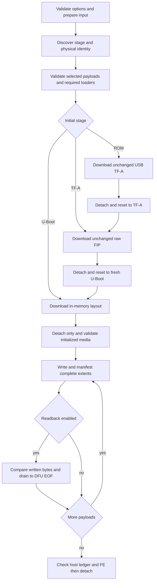

# cb_st_flasher

Native USB programming with optional read-back verification for C3/STM32MP13 control boards. The tool behind `just flash` uses gousb/system libusb, not STM32CubeProgrammer. It supports the normal MP13 ROM → USB TF-A → U-Boot `stm32prog` bootstrap and direct attachment to a fresh `stm32prog` service.

**Hardware qualification is still required.** Host protocol models and signed-image reconstruction checks are not proof of ROM/USB compatibility, GPT behavior, fused-key trust, or successful board boot. See [Qualification](#qualification).

## Build and runtime prerequisites

Activate the repository's Hermit environment for Go and just:

```sh
source bin/activate-hermit
# Search Hermit before installing native packages; no libusb package was available.
hermit search libusb
```

System prerequisites:

- macOS: Xcode Command Line Tools, `libusb`, and `pkg-config` (`brew install libusb pkg-config`).
- Debian/Ubuntu: `build-essential`, `libusb-1.0-0-dev`, and `pkg-config`.
- Released binaries also require the native libusb shared library at runtime. Linux users need permission to access the USB device.

```sh
CGO_ENABLED=1 go test ./tools/cb_st_flasher/...
just -f tools/cb_st_flasher/justfile build
just -f tools/cb_st_flasher/justfile run --help
```

The local recipe invokes the repository's Hermit Go shim explicitly, keeping the Go driver/compiler/assembler consistent even if another Go installation precedes it on `PATH` or supplies an inherited `GOROOT`. It accepts only the host OS/architecture. Release CI builds Darwin/Linux amd64/arm64 on four native runners, tests them, and launches each binary's help before packaging. Only `cb_st_flasher` uses CGO; `distro`, `opkg-inject`, and the peer network flasher [go_fastboot](../go_fastboot/README.md) remain CGO-free. All four binaries ship in the existing `distro-tools` bundles; `just flash` remains USB-only.

### Linux USB permissions (udev)

C3 flashing uses USB vendor `0483` (STMicroelectronics), product `df11`
(STM32 DFU). The flasher selects this same ID during ROM, TF-A, and U-Boot
discovery, including after USB re-enumeration. No serial-port rule is needed:
libusb accesses `/dev/bus/usb`, not `/dev/ttyACM*`.

Install a device-specific rule owned by `root:plugdev`. Run these commands as
your normal user, not from a root shell. This works for local desktops and
headless/SSH sessions without running the flasher as root:

```bash
bash -c '
if ! getent group plugdev >/dev/null; then
  sudo groupadd --system plugdev
fi
sudo usermod --append --groups plugdev "$(id -un)"
sudo tee /etc/udev/rules.d/70-c3-flash.rules >/dev/null <<EOF
ATTRS{idVendor}=="0483", ATTRS{idProduct}=="df11", MODE="0660", GROUP="plugdev", TAG+="uaccess"
EOF
sudo udevadm control --reload-rules
sudo udevadm trigger
'
```

Log out and back in so the `plugdev` group membership applies. Unplug and
reconnect the board in USB programming mode so udev applies the rule.
The rule also grants access to other STM32 DFU devices with this ID; it does
not grant access to every ST USB device or make USB devices world-writable.

Check access as your normal user:

```sh
lsusb -d 0483:df11           # Find the device's Bus and Device numbers.
ls -l /dev/bus/usb/001/002    # Replace 001/002 with those numbers.
cb_st_flasher devices        # Source checkout: bin/scripts/cb_st_flasher devices
```

The USB device node should be owned by `root` and group `plugdev` with group
read/write permissions (`crw-rw----`, possibly with an ACL marker). If `lsusb`
finds no matching device, check the cable and board programming mode; permissions
alone cannot make a missing device appear. `devices` reads descriptors only,
so successful listing does not prove interface-claim or flashing access.
After checking node permissions, run the normal flash command to verify access
across the bootstrap's USB disconnect/reconnect transitions.

On Linux, a libusb access-denied error also prints these setup commands.
The flasher does not install rules or change host permissions automatically.

## Usage

Connect exactly one supported STM32MP13 USB device. For direct U-Boot flashing, enter the service with `reboot --st-dfu` on the **designated test board**, not `--dfu` or `--fastboot`.

```sh
# List all connected STM32 DFU candidates without flashing
cb_st_flasher devices
just -f tools/cb_st_flasher/justfile run devices

# Full partition selection with AVB body and tail binaries (verity enabled by default)
cb_st_flasher artifacts/miner-image-latest/

# Plain ext4 without AVB metadata
cb_st_flasher --no-verity artifacts/miner-image-latest/

# Rootfs_a plus environment erase; validates the existing GPT
cb_st_flasher --rootfs-only artifacts/miner-image-latest/

# With verification enabled, omit supported AVB padding writes, not readback
cb_st_flasher --verify --verity --rootfs-only artifacts/miner-image-latest/

# Only these partitions
cb_st_flasher -p bootfs -p rootfs_b artifacts/miner-image-latest/

# Add rootfs_a to the boot-chain selection
cb_st_flasher --no-rootfs -p rootfs_a artifacts/miner-image-latest/

# Default: full programming without partition readback
just flash

# Opt in to read-back content verification
just flash --verify artifacts/miner-image-latest/

just -f tools/cb_st_flasher/justfile run --help
```

Flashing requires exactly one image directory or ZIP argument. `devices` takes no image argument and lists all connected `0483:df11` candidates with their product, serial, bus/port path, and descriptor-based stage or rejection reason. It only reads USB descriptors: no configuration changes, interface claims, DFU commands, downloads, detach, or reset. A descriptor match does not prove that the service has an unparsed layout; flashing checks that separately.

Directory inputs are never removed. ZIPs are streamed into an owned temporary directory and removed during normal cleanup; forced termination can leave that directory behind. Adjacent directories are untouched. Traversal, symlink entries, duplicate files, and conflicting destinations are rejected.

### Options and selection

- `--mmc-dev 1` (default): eMMC; `--mmc-dev 0`: SD. Other values fail before USB or extraction. Both use the existing board layout and a 512-byte logical-sector contract; SD needs separate medium qualification.
- No selection flags: full default operations in the [shared host profile](../flashimage/layout.go).
- `--rootfs-only` / `--rootfs`: write `rootfs_a`, erase `u-boot-env`.
- `--no-rootfs`: write exactly `fsbl1`, `fsbl2`, `metadata1`, `metadata2`, `fip-a`, and `bootfs`.
- Repeated `-p` / `--partition`: replace the default full selection; add to `--rootfs-only` / `--no-rootfs` otherwise.
- `rootfs` aliases `rootfs_a`; selecting `metadata1` also selects `metadata2`.
- Selecting `fip-b` keeps it reserved with no payload. Selecting `u-boot-env` is erase-only.
- `--erase-all`: takes precedence over normal selections and erases boot1, boot2, and the user-area RawImage. No rootfs payload is loaded or optimized.
- `--signed` defaults true and selects signed bootloader artifacts; `--signed=false` selects unsigned TF-A artifacts. Authentication is enforced by firmware, not bypassed by this option. MMC0 retains its existing SD-artifact pattern.
- `--verify` defaults false. Default flashing (equivalent to `--verify=false`) skips partition readback entirely but retains all writes, manifestation, virtual phase checks, and completion tracking. It cannot detect stored-content mismatches; output explicitly reports unverified programming. Add `--verify` to enable read-back comparison. Virtual status uploads still occur in either mode.
- `--verity` defaults true: require plain `.rootfs.ext4` plus its same-path `.avb.body` and `.avb.tail` files for selected rootfs slots. Full `.avb` and compact `.avb.footer` artifacts are not consumed. Omit unused partition padding writes without erasing. Non-rootfs payloads still write in full.
- `--no-verity` (or `--verity=false`): write plain rootfs without requiring or writing AVB metadata. This does not disable firmware verification. Explicit `--verity` and `--no-verity` together are rejected before image or USB access.
- `--debug`: enable artifact-discovery diagnostics.

`--rootfs-only` and `--no-rootfs` are mutually exclusive. Unselected layout rows remain present to describe partition geometry.

## USB session and safety

The tool identifies stages by DFU interface/alternate descriptors, not VID/PID alone. It rejects ordinary DFU, MCU DfuSe, MP15 layouts, SSP provisioning, unknown stages, and preloaded/interrupted U-Boot layouts. Initial U-Boot attachment must report phase zero with no parsed layout. Restart `stm32prog` after an interrupted operation; there is no implicit resume.

A stable physical USB bus/port is mandatory. Bus zero is valid, including on macOS, but a nonempty port path is still required. Re-enumeration follows that same port and checks the UID serial when available. An unrelated newly appeared device is never selected.

After an intentional stage/layout transition, discovery waits at most 120 seconds for the expected descriptors. Transient stalls, I/O or generic backend errors, disconnects, timeouts, or changing enumeration data cause a fresh read-only discovery attempt; USB string reads use live descriptor indices and bounded control transfers. Darwin maps some not-responding/aborted requests to libusb `OTHER` (`-99`). A persistent descriptor error fails at the deadline and retains the last underlying error. The same physical port, UID, and submitted layout must still match. This does not retry configuration claims, DFU transactions, or uncertain writes.

On Linux, a `NO_DEVICE` error while opening the single matching device during an expected re-enumeration is retried the same way.

U-Boot's [DFU detach handler](https://github.com/STMicroelectronics/u-boot/blob/d1bbf3f7edb786fe854034810355e750b08a9851/drivers/usb/gadget/f_dfu.c#L358-L372) temporarily exposes a DFU runtime interface (`FE/01/01`) before rebuilding its DFU-mode alternates (`FE/01/02`). During an expected reconnect, a valid runtime descriptor causes another read-only discovery attempt within the same deadline, not a fatal mixed-protocol error. It is never accepted for flashing or initial attachment. Malformed or genuinely mixed live interfaces remain fatal; no extra detach, reset, or write is issued.



The six-column FlashLayout is constructed only in memory: no host filename column, bootstrap rows, generated TSV file, or raw layout logging. Layout initialization can erase selected erase-only areas and create/check GPT **before** payload writes:

- Any unselected row means a partial update; existing GPT starts/sizes must match.
- All rows selected, including reserved/erase-only rows, permit a full GPT update. Full flashing does **not** promise GPT preservation.
- `P` writes do not imply erase; `PE` reserves/skips without erase; `PDE`/`PED` erase without payload; `-` preserves.

Every download completes manifestation before the next transaction. With `--verify` enabled, readback compares every written artifact byte, including explicit zero padding through the final 512-byte sector, then drains to the DFU backend's true EOF. It does not send ABORT or a nonzero read offset: these do not safely end this firmware's read transaction. Small images in large partitions can therefore require much more readback than download traffic. Default flashing avoids this cost by doing no partition readback, not by weakening transaction cleanup. RAM loaders, layout text, and virtual commands are not sector-padded.

Backend EOF is not always the physical partition's end. The pinned firmware's [MMC size multiplication](https://github.com/STMicroelectronics/u-boot/blob/d1bbf3f7edb786fe854034810355e750b08a9851/drivers/dfu/dfu_mmc.c#L253-L260) can overflow at 32 bits: an 11,509-MiB data area yields 3,478,126,592 readable bytes. The host still requires and compares every planned written extent when verification is enabled; reported readback bytes do not assert that all physical tail sectors were read.

Ctrl-C, DFU/status errors, permanent USB discovery errors, phase errors, and verification mismatches stop the operation without replaying uncertain writes or resetting the board. A completed host ledger and target FE are required before final DETACH. U-Boot then unregisters its programming gadget; the host does not issue another bus reset or claim an observed OS boot. Depending on the firmware caller, the board may remain at `STM32MP>` or boot/reset itself. To reset manually from the console, use U-Boot's `reset` command with the board configured for the intended boot source. ROM/TF-A bootstrap resets remain unchanged.

The first Ctrl-C (or SIGTERM delivered to the flasher) requests cancellation and starts one two-second budget for work and cleanup. A second SIGINT/SIGTERM exits immediately with status 1; expiry of the budget also forces status 1, even if native USB work, cleanup, or diagnostic output is stuck. Forced exit skips unfinished defers and cannot undo a request already accepted by firmware. Before retrying, return to a known ROM entry or restart `stm32prog`; there is no automatic reset, replay, or resume.

This applies to the native binary and normal foreground `just flash`/source-run commands. The budget starts when the installed flasher handler receives the first signal, not during Go compilation or Hermit activation. A signal sent only to an arbitrary wrapper PID is not forwarded; terminal Ctrl-C reaches the foreground process group.

### Bootstrap and OTP

ROM requires USB TF-A and raw OP-TEE FIP in addition to selected storage payloads; TF-A requires only FIP; direct U-Boot requires only selected storage artifacts. Discovery rejects missing or ambiguous required files without demanding unrelated images.

At reset sites only, libusb `NOT_FOUND` means the old handle needs rediscovery, just like a disconnected old device. Bootstrap closes that handle and requires the expected next stage on the same physical port and UID before continuing; the reset result alone is not bootstrap success. The same code from a DETACH or data transfer remains fatal. See the [libusb reset contract](https://libusb.sourceforge.io/api-1.0/group__libusb__dev.html#gafee9c4638f1713ca5faa867948878111).

Use approved, rollback-compatible signed loader/FIP versions and boards authorized for their firmware effects. The complete STM2 v2 header/extensions and raw FIP are transmitted unchanged. Firmware authentication can advance rollback OTP state; removing host OTP provisioning does not remove firmware-side OTP effects. No claim is made that every historical prebuilt image contains the current rollback patch.

## AVB optimization

Selected `rootfs_a`, `rootfs_b`, and `recovery` writes require plain ext4 plus its `.avb.body` and `.avb.tail` files in the directory or ZIP by default. All three files are checked before bootstrap or programming. The body and tail pathnames must equal the selected ext4 pathname plus their respective suffixes. Missing, ambiguous, cross-version, compact-only, and full-image-only inputs fail. Non-rootfs, erase-only, and `--no-verity` selections do not require metadata.

`--verity` automatically discovers both metadata files and always writes raw rootfs, body, and tail together for each selected rootfs slot. There are no separate body/tail options or metadata-only write mode. Use `--verity -p rootfs_b` to update only that slot, or `--verity --rootfs-only` to update rootfs_a and erase u-boot-env.

The flasher treats these as ordinary binary files. It checks that all three are regular and nonempty, raw and body lengths are 512-byte aligned, tail length is exactly 512 bytes, and the ranges fit without overlap in the selected partition's known fixed capacity. It performs **no AVB framing, signature, rootfs-content, or key-trust validation**. Establish trusted matching inputs separately with the signer/verifier; pathname and size matching are not cryptographic proof.

Let `P` be that derived capacity (currently 1073741824 bytes for each C3 rootfs slot), `O` the raw ext4 length, and `B` the body length. The writes cover `[0,O)`, `[O,O+B)`, and `[P-512,P)`, using each source file from offset zero. The body includes its alignment padding; the tail includes 448 padding bytes and the 64-byte AVB footer. The 512-byte sector contract is distinct from hashtree and avbtool block sizes. Each partition uses one programming phase with multiple write ranges, not a padded image or staging file. Preparation output lists each source basename and size.

The omitted target gap is **not erased**, may retain previous bytes, and is not compared. With `--verify`, readback still drains to partition EOF and compares only written extents. Readback defaults off and does not establish authenticity. No signature, GPT, erase, environment-selection, or bootstrap policy changes are implied. This is not secure erase or byte-for-byte full-image equality; byte savings do not establish wall-clock savings.

## Partition layout

The [declarative C3 profile](../flashimage/layout.go) is the host flashing authority for both `cb_st_flasher` and `go_fastboot`: canonical names, aliases, physical address areas and offsets, artifact relationships, selection annotations, AVB eligibility, and transport selection rules. Consumers receive comparable values, not mutable backing tables. All C3 board revisions share this profile.

Fixed capacities derive from the next boundary in the same user address area, independently of selected rows and flash order. Boot1 and boot2 are separate hardware areas with unknown fixed capacity; data grows to the device end. Neither receives an inferred AVB tail. Boot/data/raw operations retain conservative descriptor bounds; displayed USB MiB values are not exact capacity queries. Empty payloads and sector-rounded writes beyond those bounds fail.

The profile governs host flashing only. Python AVB generation, artifact/SWU tooling, Yocto, and U-Boot definitions remain independent and unchanged. A profile edit alone does not qualify new hardware or recovery behavior. Unlike this tool's strict `--verity` policy, fastboot warns and skips both companions when either exact companion is missing; neither fallback disables device verified boot.

## Qualification

Local proof covers deterministic stateful protocol/selection/AVB/ZIP tests, race checks, actual CLI option/no-device behavior, Darwin/arm64 native build and bundle membership, and the real signed AVB reconstruction described above. Linux amd64/arm64 and Darwin amd64 native runner results remain unobserved until CI runs. No release was published for testing.

Runtime-to-DFU rediscovery regressions cover the detach-time descriptor transition, persistent runtime timeout, cancellation, initial runtime rejection, and malformed/mixed-interface rejection. They reproduce the premature failure before the fix and pass with the corrected discovery handling.

A full ROM-bootstrapped default flash with `--verity` (no `--verify`) has been verified from a Raspberry Pi 5 linux-arm64 host to a C3 STM32MP131F Rev.Y, which then booted from eMMC. Readback verification and Linux amd64 remain unqualified.

Interrupt lifecycle subprocess regressions cover SIGINT/SIGTERM cancellation, blocked work and cleanup, second-signal escalation, blocked stderr, repeat-safe timer disarm, and actual main help/error exits. Hardware-free Darwin/arm64 PTY checks using the production interrupt helper and a non-returning CGo call passed all seven launch paths (root `just flash` with default/explicit arguments, source script, tool justfile, Hermit just, `go run`, and native binary). Graceful cleanup exited in 0.102–0.110 seconds, blocked native work in 2.001–2.009 seconds, and second-interrupt cleanup exits within 0.05 seconds; no recorded wrapper or Go child survived. Linux interrupt runtime qualification remains unobserved.

Read-only discovery and native ROM → TF-A → fresh U-Boot `stm32prog` bootstrap have been verified on a connected STM32MP131F Rev.Y board using macOS bus zero. The bootstrap-only run transmitted the unchanged 93,376-byte signed USB TF-A and 1,486,896-byte raw FIP, validated the same port/UID and fresh service, and exited successfully before FlashLayout submission. It did not write eMMC partitions or establish OS boot/full-flash qualification. Before deployment/manufacturing use, qualify on a disposable C3 with known 512-byte-sector media, approved signed images, saved preservation checksums, UART capture, and explicit overwrite authorization:

- Direct fresh `stm32prog` with `--verify --verity`: full selection and rootfs-only with automatic AVB optimization, expected env erase, GPT checks, unchanged unselected partitions, and signed boot; seed approved unused AVB gap sectors.
- ROM boot: untouched signed TF-A/FIP bootstrap, full layout/GPT creation, and successful signed boot.
- Default flashing and explicit `--verify=false`: complete all planned writes and phase checks without partition readback, report unverified completion, and detach without a host bus reset. Do not use this mode as content-verification evidence.
- Selected bootfs/rootfs_b, paired metadata1/metadata2, and erase-all.
- Production-locked boards with approved rollback-compatible firmware; separate compatible MMC0/SD qualification.
- Interrupted transfer: nonzero exit without false success/reset, normal service recovery, then a successful rerun.
- macOS and Linux control-traffic captures for layout detach-only, bootstrap detach/reset and re-enumeration, 16-bit block rollover, repeated offset writes, and final detach timing.

## Migration and source pointers

The previous public TSV emission and OTP provisioning flags (`--only-tsv`, `--tsv-file`, `--pkhash-file`) and STM32CubeProgrammer subprocess backend were removed. There is no programmer-executable discovery, fallback backend, native OTP provisioning, ordinary-DFU backend, or Fastboot backend. System libusb is now required.

AVB padding-write optimization is now automatic with `--verity`. Remove the former `--optimize-avb` argument from scripts; it is no longer accepted. There is no AVB full-padding-write override.

- CLI/orchestration: [main.go](cmd/cb_st_flasher/main.go), [flash.go](cmd/cb_st_flasher/flash.go)
- Selection/discovery: [layout.go](cmd/cb_st_flasher/layout.go), [image.go](cmd/cb_st_flasher/image.go)
- Native protocol: [usb.go](cmd/cb_st_flasher/usb.go), [dfu.go](cmd/cb_st_flasher/dfu.go), [stm32prog.go](cmd/cb_st_flasher/stm32prog.go), [bootstrap.go](cmd/cb_st_flasher/bootstrap.go)
- AVB parsing: [avb.go](cmd/cb_st_flasher/avb.go)
- Wire-contract references: [pinned ST U-Boot](https://github.com/STMicroelectronics/u-boot/tree/d1bbf3f7edb786fe854034810355e750b08a9851/arch/arm/mach-stm32mp/cmd_stm32prog), [pinned TF-A USB bootstrap](https://github.com/STMicroelectronics/arm-trusted-firmware/blob/aa1e9e2db80e49ed0259757a0f09ff119725409d/plat/st/common/stm32cubeprogrammer_usb.c), [AN5275](https://www.st.com/resource/en/application_note/an5275-introduction-to-usb-dfuusart-protocols-used-in-stm32mp1-and-stm32mp2-mpu-bootloaders-stmicroelectronics.pdf).
