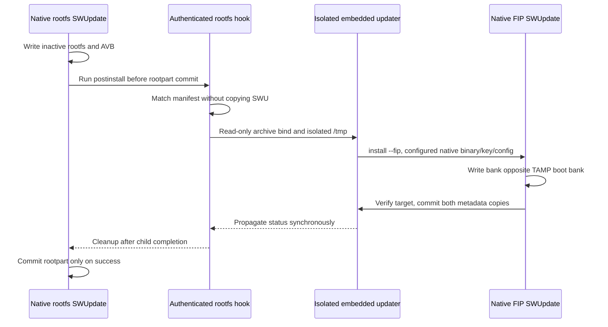

# Distro CLI — Architecture Guide

## Overview

The `distro` CLI is a Go application that orchestrates Yocto-based distro image builds, IPK package injection, and artifact fetching from GitHub. Builds run inside Docker containers. All configuration is driven by `distro.yaml`, with paths resolved relative to that file.

## Package Map

```
tools/distro/
├── cmd/
│   ├── distro/          # Main distro CLI binary
│   ├── injector/        # Container-side binary for opkg injection (runs inside Docker)
│   └── opkg-inject/     # Standalone CLI for injecting IPKs into an ext4 image
└── internal/
    ├── builder/         # Docker build orchestration and post-build artifact export
    ├── config/          # distro.yaml parsing, path resolution, signing key resolution
    ├── color/           # ANSI color formatting helpers
    ├── distroinject/    # Inject IPKs into a distro zip/folder and repackage SWU files
    ├── docker/          # Docker availability checks, image ensure, container execution
    ├── dotenv/          # .env file loader (does not overwrite existing env vars)
    ├── fileutil/        # Shared utilities: CopyFile, SHA256File, CollectIPKFiles
    ├── gh/              # GitHub CLI wrapper: tag resolution, asset downloading
    ├── opkginject/      # Host-side logic for IPK injection via Docker container
    ├── postbuild/       # Post-build artifact export and injection
    └── swurepackage/    # SWU repackage: replace rootfs, update hashes, re-sign
```

## Commands

### `build` / `shell` / `clean` / `layers`

These four commands all go through the same builder pipeline with different Docker entrypoint arguments.

1. Load config and environment variables from `distro.yaml` and `.env`
2. Check Docker is available; reuse the local builder image or pull it if missing. A failed pull stops with a `just docker-build-builder` hint; builds never start automatically.
3. On macOS, ensure a Docker volume exists for the build directory
4. Detect version from git (tagged release or short SHA with `-dirty` suffix). Full `GIT_HASH` and short-SHA fallback share dirty detection; an explicitly set `DISTRO_VERSION`, including an empty value, takes precedence over tags.
5. Assemble `docker run` arguments: volume mounts, env vars, entrypoint
6. Run the container (`build` runs bitbake, `shell` opens an interactive bash, `clean`/`layers` run their respective bitbake commands)
7. **Build only, for image targets:** export Yocto artifacts, optionally inject IPKs/VERSION, generate release/mfg AVB, rebuild every discovered SWU, then publish symlinks and ZIP

### `inject`

Injects IPK packages into a distro image (zip file or unpacked folder) and repackages any `.swu` files with the modified rootfs.

- **Zip input:** extracts to a temp directory, performs injection, then rebuilds and replaces the input zip
- **Folder input:** overwrites files in place without recovery copies or rollback

The shared build, postbuild, and inject sequence:
1. Discover plain `*.rootfs.ext4` and `.swu` files in one recursive walk, require exactly one rootfs, then select release/mfg policy and machine keys. Before mutation, validate current `.avb.body`/`.avb.tail` and recognized legacy `.avb`/`.avb.footer` outputs. Reject symlinks, non-regular files, and hardlink aliases.
2. Snapshot and sort every recursively discovered SWU. Before mutation, `swurepackage.Inspect` validates normalized CPIO membership and discovers at most one compressed rootfs and one FIP, with at least one component. Reject unsafe paths, duplicate names, links, special files, and ambiguous components. Only FIP-bearing sets require one nonempty regular `fip/fip-*.bin` beside the outer rootfs; missing, ambiguous, or symlinked FIP inputs fail before mutation. Rootfs-only sets need neither FIP nor a raw updater. Generic images without SWUs, package/VERSION mutation, or AVB work return unchanged.
3. Reuse the configured injector image, or pull it if missing. Never rebuild or install tools at runtime. Run `just docker-build-injector` after changing Python signing tools; rebuilding only the builder does not refresh the release signer. CI rebuilds the injector for PR changes to `python/`, `docker/Dockerfile.injector`, its Go command, copied `color`/`fileutil` packages, or Go module files; otherwise CI pulls the published image.
4. If requested, run the existing privileged ext4 injector through installation, postinstall scripts, VERSION updates, unmounting, and filesystem checks. Replace the plain rootfs and update the application manifest.
5. For release and mfg, invoke `create_avb_image` in a private sibling `.distro-avb-*` directory after rootfs mutation. Mount the artifact parent read-write and selected keys read-only with networking disabled. Require regular nonempty, sector-aligned raw/body and a 512-byte tail without overlap in the 1 GiB partition. Reject legacy signer outputs. Validate both sidecars before replacing either; the pair is not atomic.
   `swurepackage.ValidAVBGeometry` shares size checks across SWU assembly and verification. Bounded subtraction prevents overflow and overlap before the footer.
6. `RebuildAll` uses the same recreation core as standalone `Run`/`Preview`, but strictly verifies every staged archive. Rootfs preparation is shared per exact rootfs/body/tail input tuple: compress once, hash plain/compressed bytes and sidecars once, then copy independent files using the supplied rootfs basename plus `.gz`, `.avb.body`, and `.avb.tail`. Preserve component membership, scripts, updater, policy, modes, and unrelated members as opaque seed content. Replace exported FIP only where already present, using its supplied basename. Validate all manifest filename hashes, decompressed rootfs equality, AVB geometry, adjacency, offsets, and raw/zlib types.
   Stage rebuilt outputs in one private directory inside the artifact root, retaining relative paths. This needs no writable parent and keeps staging on the artifact filesystem, including bind mounts. Deferred cleanup runs before checksum generation. Open new outputs exclusively; failure cleanup removes only batch-owned files, never a destination that appears after preflight. Publish only after the entire batch succeeds. Each rename is atomic, not folder-wide publication. Zero discovered SWUs produces none.
   Trusted standalone `Run`/`Preview` retain targeted replacement semantics: unchanged seed members need no artifact authentication or manifest hash validation. FIP-only recreation does not stage rootfs. Neither path generates FIP bank policy or bootstrap hooks.
7. Preserve all existing legacy `.avb`/`.avb.footer` files. Standalone folder/ZIP injection writes `sha.txt` once over the full artifact root after successful changed mutation; no-work ZIPs remain byte-identical. Postbuild passes `SkipChecksums=true`, then `FinalizeArtifactOutput` copies all configured local files and writes checksums exactly once, even with no local exports, before links/ZIP publication. Failed local export never rewrites checksums. No operation creates `.original` recovery copies.

`ProcessPostBuild` and `runPostbuild` pass selected machine/variant metadata;
a contradictory canonical rootfs name fails. Standalone inject uses the rootfs
basename, not config defaults or the outer archive name. Both release and mfg
require exactly one configured machine prefix. Manufacturing sidecars are valid
regeneration inputs, including zero-package/no-VERSION runs. Generic unsigned
processing remains supported only without SWU generation.

`artifacts.files` and optional variant files describe required Yocto export sources.
`FinalizeArtifactOutput` resolves `artifacts.local_files` relative to config and
copies them by basename for every variant, independently of package injection.
This includes existing-folder CLI postbuild. The built C3 `proto-swupdate`
executable is copied before refreshing checksums and publishing ZIP/latest output.
Missing local sources prevent publication.
The configured raw updater is independent of the embedded updater. Yocto's image
recipe owns both seed variants, hook sources, and updater hash binding; host rebuilding preserves them.
The `.avb.body` and `.avb.tail` files are the only
signing outputs, included beside plain ext4 in checksums, ZIPs, CI uploads, and
version renaming. No new full-image artifact or full-image SWU payload is generated.
See [the AVB usage contract](../../python/README.md#verify-an-avb-image) for detached verification
and its fixed 1 GiB layout. Yocto's AVB task and deploy-only `rootfs.avb` alias
are retired. U-Boot still stages its machine-family native trust anchor;
`DM_VERITY_ENABLE`, kernel dm-verity, boot scripts, and bootfs/datafs are unchanged.

`avb.<machine>` provides `private_key`, `public_key`, and `avb_public_key`.
Only selected nonempty paths are resolved relative to the config, made absolute,
and symlink-resolved to readable regular files. `c3-p1` uses C3 keys.
`signing` and `--swu-key-file/--swu-key-pass` affect SWU signing only.

Signer failure stops before SWU/checksum/ZIP/latest finalization. SWU failure
retains recognized legacy siblings. ZIP injection keeps the input archive;
folder updates do not roll back already changed raw/body/tail bytes.

### Split OTA installation

For original ext4 length O, VBMeta offset V, size S, E=round_up(V+S,512), and fixed
P=1073741824, the signer publishes body bytes [O,E) and tail bytes [P-512,P).
The body includes the hashtree, VBMeta, and tiny alignment padding; the tail
contains 448 zero bytes and the standard 64-byte AVB footer.

For rootfs replacement, SWU assembly requires plain rootfs and both sidecars; it
checks matching basenames, regular nonempty inputs, sector-aligned raw/body,
exactly 512 tail bytes, and no overlap in the fixed partition. It does not parse
AVB binary fields or implement cryptography. Trusted matching inputs remain the
caller's responsibility; distro uses the freshly verified signer output.

`sw-description` selects all three raw writes for the same inactive device:

- `<root>.gz`: only plain ext4, offset 0, zlib-compressed.
- `<root>.avb.body`: supplied body unchanged, offset `os.Stat(raw).Size()`.
- `<root>.avb.tail`: supplied final sector unchanged, offset 1073741312.

CPIO order is description, signature, rootfs, body, tail, then unrelated members.
Metadata members are independently hashed copies of the published body/tail.
The signed offsets use native SWUpdate raw-handler seeking; no custom device
writer or second installation command is needed. Unused partition padding is
not transferred or erased. SWUpdate commits bootloader variables only after
successful image writes and postinstall scripts. A failed payload hash can
partially modify the inactive slot, but must not commit `rootpart`.

Native SWUpdate commit `498de8f1c086fae1eeeb64b045d0f861575b1e66` was exercised
with real signed split SWUs, file-backed A/B slots, and file-backed U-Boot
variables. Both selections passed trusted AVB verification. Missing tail,
corrupt body/tail, and signed-offset tampering failed without changing the
active slot or committing `rootpart`. Hardware boot, power-loss behavior,
and deployed SWUpdate versions remain unqualified.

The updated proto-swupdate reads the mounted root's device number with `findmnt`
and resolves its partition through sysfs. It supports a direct partition or one
device-mapper layer with a single backing partition; ambiguous or unsupported
layouts fail before slot selection.

Old updaters extract trailing digits from the root source: `/dev/dm-0` becomes
partition `0`, which can select the active slot as the update target. **Do not use
an old updater for rootfs OTA on a dm-verity boot.** For the first migration,
run the corrected updater from RAM or explicitly select the verified inactive
slot with native SWUpdate. Installing the corrected updater in the incoming
rootfs cannot fix the old process before it chooses a slot. Separate bootfs OTA
and production trust provisioning remain outside this change.

`miner-image-swupdate.bb` creates both seed archives in its existing image task.
Both reuse `sw-description.in` for rootfs policy. The recipe inserts companion
rootfs hooks and the FIP-only `sw-with-fip-description.in` fragment before the
class's native `@@VARIABLE@@` expansion and payload-hash helpers sign the manifest.
The task depends on image completion, trusted-firmware deployment, and
`proto-swupdate:do_deploy`. The updater's deploy task publishes its unpacked binary
through deploy sstate; SWU assembly never reads the transient image rootfs.
One shared build loop stages both variants with the class's source and artifact
helpers, without recompressing the rootfs. The companion adds the exact configured
FIP, deployed updater, and recipe-local hooks. Both variants use the class's signing
helper and checked CPIO packing in independent clean staging directories.
Seeds have no host-generated AVB sidecars and are not installation-ready bundles.
Required archives are selected by artifact configuration, not postbuild naming
policy. `ProcessPostBuild` checks the release/mfg rootfs/body/tail trio before
publication; unsigned base images can publish without SWUs.


### `swu-recreate`

Recreates exactly one signed SWU using the supplied seed component layout.
`swurepackage.Run`/`Preview` select only explicitly supplied `--rootfs FILE` and/or
`--fip FILE` replacements. At least one is required; each must exist in the seed.
Other components need no replacement. Positional arguments and extra component
inputs fail. FIP-only replacement needs no rootfs or AVB input, even when the seed
contains rootfs. The replacement rootfs basename must end in `.rootfs.ext4` so
the unchanged seed updater recognizes the resulting `*.rootfs.ext4.gz` member.
Replaced members use the supplied basename: rootfs adds `.gz`,
its sidecars add `.avb.body`/`.avb.tail`, and FIP uses its basename, which must
match `fip-*.bin`. Name collisions fail. Only matching manifest entries' filenames,
hashes, and required rootfs/AVB geometry change. Standalone rootfs replacement
requires `--version VERSION` (forbidden without `--rootfs`) and updates software
version in `sw-description`, preserving the existing `-release`/`-mfg`/`-dev` suffix.
The option does not change VERSION inside ext4. FIP-only replacement preserves
manifest version. Build/postbuild/inject pass an explicit VERSION override only
for rootfs jobs; without an override they preserve existing manifest version.
Hardware, selections, scripts, existing bootstrap, and unspecified members and
manifest entries remain unchanged. No generic-file API,
paired output, bootstrap-updater input, Docker, or AVB signer is involved.
Preview stays local and read-only; final publication remains exclusive.
Unchanged member hashes and file references are not checked, including scripts in
`copy1`/`copy2`. Recreation neither validates nor repairs seed installability.
Callers supply a suitable seed; stale hashes or absent files in installed
selections can still fail SWUpdate verification on the device. Re-signing the
manifest does not validate unchanged payloads.

The recipe owns the companion's FIP bank policy and archive-only updater.
It binds the updater SHA-256 into the bootstrap hook and hashes that hook in both
rootfs postinstall records. Yocto integration checks validate exact membership,
bank selections, executable modes, and hash binding. Updater runtime tests execute
the recipe-owned template. Distro rebuilding treats preserved members as opaque
content and checks generic manifest payload hashes, not script-internal policy.



The companion is a manual migration/recovery artifact, never a Memfault/Suricatta
or distributed OTA payload. It requires a complete regular SWU under `/data` or `/tmp`.
Mount isolation belongs only in the generated hook. TMPDIR alone cannot isolate
the native fixed `/tmp/swupdate.sock` and `/tmp/swupdate.progress` listeners.
The private namespace also separates scripts, manifest, and boot-script. Its
workspace starts under `/tmp/.proto-swupdate-bootstrap.*`. Discovery retains
the selected pathname in a symlink instead of copying the archive. The child
bind-mounts that source file read-only onto an empty placeholder, then recursively
binds the inner workspace over `/tmp` to preserve the archive submount. It
rechecks the active manifest and extracts/hashes the updater before execution.
Absolute child paths stay visible without allocating another SWU-sized file.
The source inode stays pinned, but concurrent writes through other paths remain
unsupported; keep the source archive unchanged during installation. Discovery
reuses one manifest scratch file and one error file only on failure. Manifest
files are removed before execution; the exit trap removes staging and
child-created files after completion or handled signals. Volatile `/tmp` handles
untrappable termination at reboot. FIP children use `-M -m -P '' -p ''` to suppress
state/transaction markers and configured pre/post callbacks. Running-executable
PATH precedence keeps the normal FIP postinstall hook on the embedded updater.
Modern proto-swupdate owns the FIP pass and sets `PROTO_SWUPDATE_SKIP_FIP=1` in
every native child, so legacy bootstrap cannot cause a duplicate FIP pass.
For legacy callers, nested FIP completes before any second outer FIP pass; the
shared `/run/proto-swupdate/fip-install` handoff remains sequential.
Missing or ambiguous archives across `/data` and `/tmp` and discovery-command failures print a
`FIP bootstrap:` diagnostic and skip bootstrap with exit 0. Active manifest
and setup failures remain fatal, as do manifest recheck, updater integrity,
mount, extraction, and nested installation failures after archive selection.

Physical boot, power-loss atomicity, production trust, and concurrent updates
remain unqualified. See [bootstrap prerequisites](README.md#legacy-fip-bootstrap).

For rootfs replacement, read-only preparation validates exact sidecar names, regular nonempty files, sector alignment, and nonoverlapping offsets. Execution compresses only plain ext4, copies body/tail unchanged, rewrites matching replaced entries in each A/B selection, and signs the manifest. A sibling staging directory and exclusive hard-link publication prevent overwriting existing outputs. Seed metadata, scripts, unrelated members, and payload ordering are preserved.

`--dry` uses `cpio -it` and `cpio -itv` without extraction to validate member paths, file types, and link counts, then streams hashes for the seed, trio, selected SWU credentials, and config. Both preview and execution reject symlinks, hardlinked files, and special files before extraction. Dry mode creates no files. Geometry checks do not authenticate AVB; manifest rewriting and credential usability remain execution-time checks. Reports contain credential fingerprints and must be kept private.

Automatic OTA consumers select exactly one canonical SWU and exclude
`-with-fip.swu`, regardless of ZIP/catalog ordering. Explicit upload remains the
opt-in path. FIP bank/TAMP behavior is unchanged:
missing TAMP can skip FIP successfully; this is not atomic rootfs/FIP installation
or health-based rollback.

### `fetch`

Downloads release artifacts from GitHub repositories. Source definitions (repo,
tag prefix, file pattern) come from `fetch.sources` in the selected configuration.
The root `distro.yaml` defines none; use
`distro --config path/to/fetch.yaml fetch ...` with consumer-defined sources.
Source flags are generated from their configured names, not built-in defaults.

1. Require at least one configured source flag and verify `gh` authentication
2. For each configured source flag provided:
   - Resolve the tag (`latest` finds the newest tag matching the configured prefix; otherwise verifies the tag exists)
   - Download matching release assets, skipping files that already exist locally with matching size and checksum
3. Output a summary (or `--json` for machine-readable output)

## Three Binaries

| Binary | Where it runs | Purpose |
|--------|--------------|---------|
| `distro` | Host | Distro CLI commands; signed-image Bash recipes invoke `swu-recreate` |
| `opkg-inject` | Host | Standalone IPK-into-ext4 injection tool |
| `injector` | Inside Docker (privileged) | Mounts ext4, runs `opkg install`, runs postinstall scripts |

The host side validates inputs, copies the image to a temp directory, estimates disk space needs, and launches the Docker container. The container side handles the privileged operations: filesystem checks, image resizing, mounting, and package installation.

Changing `cmd/injector/main.go` requires rebuilding the injector Docker image.

## Configuration: distro.yaml

Key sections (see `config.Config` struct for full schema):

| Section | Purpose |
|---------|---------|
| `defaults` | Default machine, distro, variant, env file path |
| `docker.builder` | Builder image, Dockerfile, volumes, mounts, env passthrough |
| `docker.injector` | Injector image and Dockerfile |
| `signing` | SWU signing keys (`key_dir`, `private_key`, `passfile`) |
| `avb.<machine>` | Independent rootfs `private_key`, `public_key`, `avb_public_key` paths |
| `version` | Git tag pattern/prefix for version detection |
| `fetch.sources[]` | GitHub repos and tag prefixes for `distro fetch` |
| `injection` | Auto post-build injection config (variants, packages, sources) |
| `artifacts` | Output paths, file patterns, deploy app list |
| `build_stats` | Paths to measure for build stats output |
